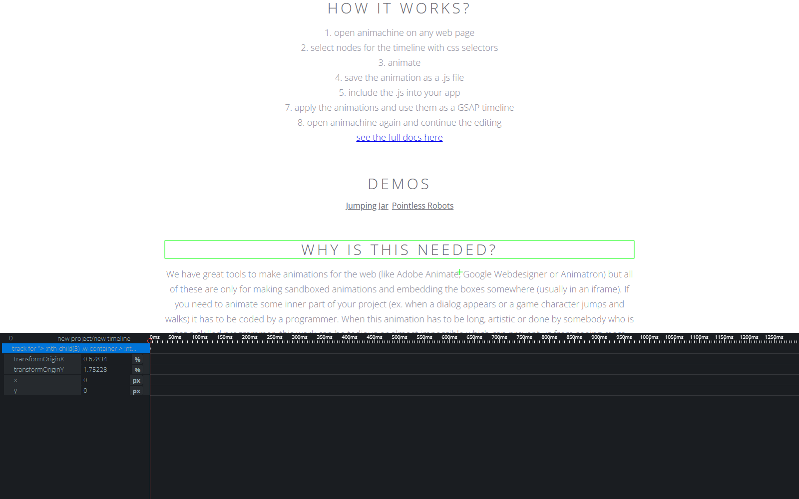
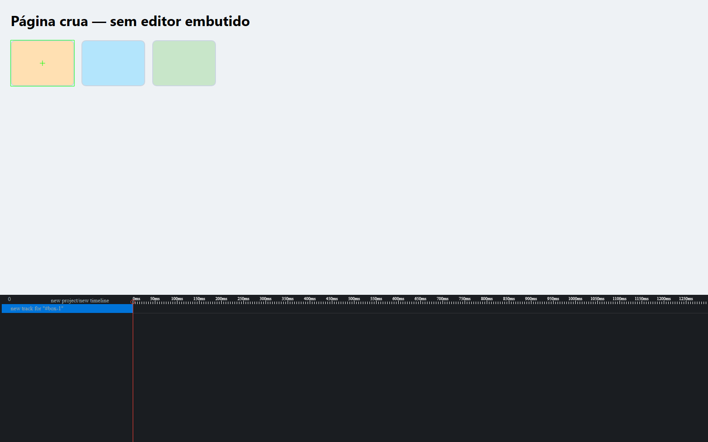

# animachine — Manifest V3 port

A Chrome **Manifest V3** port of [animachine](https://github.com/animachine/animachine): a visual
GSAP timeline editor that runs **inside any web page**, lets you pick DOM elements with CSS
selectors and animate them with a timeline — then export a `.am.js` GSAP bundle for your site.



> **Unofficial port.** animachine was created by **Polgár András** ([@azazdeaz](https://github.com/azazdeaz))
> and published as MIT in 2016 — original project: <https://github.com/animachine/animachine>.
> This repository keeps the original code and adds the changes needed to run it today as an MV3
> extension. Not affiliated with the original author.

## Why this port exists

The original editor was shipped as a Chrome **MV2** extension that injected its bundle from
`rawgit.com` (a CDN shut down in 2019). Modern Chrome rejects MV2, so the original can no longer be
installed. This port:

* packages the editor as a **Manifest V3** extension (service worker + `chrome.scripting`);
* injects GSAP and the editor into the page's **main world** (works with page CSP, no mixed content);
* **embeds** GSAP and Font Awesome instead of loading them from dead CDNs;
* fixes the build for current Node.js (webpack 1 / babel 5 kept as-is);
* fixes the DOM picker (visible `+` button, selector `:scope` handling, error toasts);
* adds **save/open project** (`.am.json`) next to the original `.am.js` export;
* adds a bookmarklet (no extension needed) and a diagnostics helper.

## Screenshots

| Pick an element and press `+` | Timeline, tracks and export menu |
|---|---|
|  |  |

## Install (unpacked extension)

Requirements: **Node.js 18+**, npm, and Chrome/Chromium.

```powershell
git clone <this-repo> animachine-mv3
cd animachine-mv3
.\scripts\bootstrap.ps1        # fetches the two missing sibling libs, installs deps, builds
```

Then:

1. open `chrome://extensions` and enable **Developer mode**;
2. **Load unpacked** → select the `extension/` folder;
3. open any page (http/https/file) and click the **animachine** toolbar icon.

Clicking twice is harmless (the editor initializes once).

## Usage

1. Click the toolbar icon → dialog **Hello!** → **start**.
2. Click an element on the page → a dashed outline with a **cyan `+`** appears → click `+`
   (this creates a track with a CSS selector for that element).
3. Drag the element body → `x`/`y` change and a **keyframe is created at the playhead**.
   Edges = scale, outside the corners = rotation. `Shift` keeps proportions.
4. Move the playhead on the ruler and edit again to create more keys (tweens).
5. Toolbar menu (circle at the right of the timeline): `save file` (`.am.js`),
   `save/open project` (`.am.json`), undo/redo.
6. In your site: load GSAP + the exported `.am.js` and play the timeline
   (`window['<project>']['<timeline>'](document.body)`), or use `animachine-connect` in React.

If the picker cannot reach an element (iframe, Shadow DOM), use the menu entry
**add track (css selector)** and type a selector such as `.hero h2`.

Full notes (setup details, troubleshooting, known issues): [`USAGE.md`](USAGE.md).

## What changed vs. upstream

| Area | Change |
|---|---|
| Extension | new MV3 manifest + service worker (`chrome.scripting`, `world: 'MAIN'`) replacing MV2 `content-script.js` |
| Assets | GSAP 1.20 and Font Awesome 4.6.3 embedded (were loaded from CDN / rawgit) |
| Fonts | CSS generated at runtime with `chrome-extension://` URLs and family `animachine-fa` (no page-origin 404, no site CSS conflicts) |
| Picker | `+` button always visible, track created on `mousedown` with the picked node cached, error toast + `animachineDiag()` |
| Selectors | `:scope > …` only as the first selector segment (fixes invalid `> :nth-child(…)` selectors) |
| Project | `save/open project (.am.json)` (the original `.am.js` export is kept) |
| Build | build fixes for Node 22, `npm` overrides, sibling libs fetched by `scripts/bootstrap.ps1` |
| Docs | `USAGE.md` (pt-BR) with the verified workflow, troubleshooting and patch list |

Not ported / still missing: the original demo scenes (`#/Robots` is absent from upstream master),
reopening a `.am.js` (only `.am.json` is a project format), and the inline easing editor is present
but untested.

## Build details

The 2016 app depends on two libraries that were never published to npm:
`spaceman` and `quick-interface`. `scripts/bootstrap.ps1` fetches them as sibling folders
(`../spaceman`, `../quick-interface`), installs their runtime deps, and links the required
`babel-loader`/`afflatus`/`react` modules. Then:

```powershell
.\build-extension.ps1          # compiles src/ and refreshes extension/ (animachine.js)
```

The compiled `extension/animachine.js` is not committed (see `.gitignore`).

## License and attribution

* Original work: **animachine** © 2015 Polgár András, MIT — <https://github.com/animachine/animachine>
* This port: same **MIT** license (see [`LICENSE`](LICENSE)); modifications © the contributors,
  made in 2026.
* Font Awesome 4.6.3 (SIL OFL 1.1) and GSAP 1.20 (GreenSock's standard license, now free) are
  bundled as assets so the editor runs offline; no proprietary Adobe/Animate material is used.

---

## Português (Brasil)

Port **não oficial** do animachine (editor visual de timelines GSAP, de 2016, por Polgár András) para
**Manifest V3** do Chrome. O original era extensão MV2 e carregava o bundle do `rawgit.com` (morto),
então não instala mais.

O que este port acrescenta: extensão MV3 que injeta o editor em qualquer página, GSAP e Font Awesome
embutidos, build corrigido para Node atual, correções no picker e nos seletores CSS, salvar/abrir
projeto (`.am.json`) e um bookmarklet como alternativa sem instalar extensão.

Para usar: `.\scripts\bootstrap.ps1` → `chrome://extensions` → **Load unpacked** na pasta
`extension/` → clicar no ícone em qualquer site. Fluxo e troubleshooting detalhados em
[`USAGE.md`](USAGE.md) (em português).

Projeto original: <https://github.com/animachine/animachine> (MIT, 2016).
