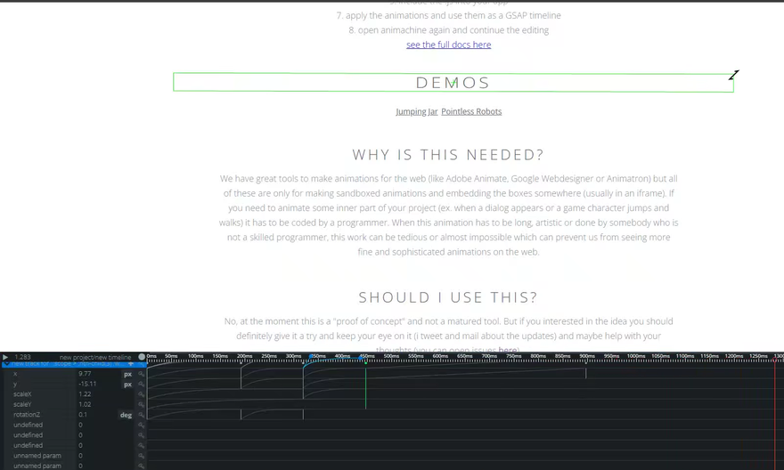
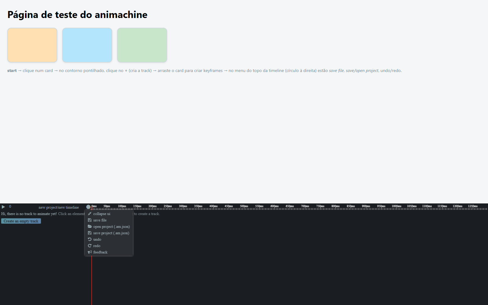

# Animachine — Manifest V3 port

A Chrome **Manifest V3** port of [animachine](https://github.com/animachine/animachine): a visual
GSAP timeline editor that runs **inside any web page**, lets you pick DOM elements with CSS
selectors and animate them with a timeline — then export a `.am.js` GSAP bundle for your site.

<picture>
  <source srcset="demo.avif" type="image/avif">
  
</picture>

*Demo (animated AVIF). If it shows as a still image, open [`demo.avif`](demo.avif)
in a browser to watch the animation.*

> **Unofficial port.** animachine was created by **Polgár András** ([@azazdeaz](https://github.com/azazdeaz))
> and published as MIT in 2016 — original project: <https://github.com/animachine/animachine>.
> This repository keeps the original code and adds the changes needed to run it today as an MV3
> extension. Not affiliated with the original author.

## Why this port exists

The original editor was shipped as a Chrome **MV2** extension that injected its bundle from
`rawgit.com` (a CDN shut down in 2019). Modern Chrome rejects MV2, so the original can no longer be
installed. This port:

* packages the editor as a **Manifest V3** extension (service worker + `chrome.scripting`);
* injects GSAP and the editor into the page's **main world** (works with page CSP, no mixed content);
* **embeds** GSAP and Font Awesome instead of loading them from dead CDNs;
* fixes the build for current Node.js (webpack 1 / babel 5 kept as-is);
* fixes the DOM picker (visible `+` button, selector `:scope` handling, error toasts);
* adds **save/open project** (`.am.json`) next to the original `.am.js` export;
* adds a bookmarklet (no extension needed) and a diagnostics helper.

## Screenshots

| Pick an element and press `+` | Timeline, tracks and export menu |
|---|---|
|  |  |

## Install (unpacked extension)

Requirements: **Node.js 18+**, npm, and Chrome/Chromium.

```powershell
git clone <this-repo> animachine-mv3
cd animachine-mv3
.\scripts\bootstrap.ps1        # fetches the two missing sibling libs, installs deps, builds
```

Then:

1. open `chrome://extensions` and enable **Developer mode**;
2. **Load unpacked** → select the `extension/` folder;
3. open any page (http/https/file) and click the **animachine** toolbar icon.

Clicking twice is harmless (the editor initializes once).

## Install from the release (no build, no Node.js)

If you just want to use the editor, grab the packaged zip from the
[**Releases**](../../releases) page:

1. download `animachine-mv3-v0.4.1.zip`;
2. extract it (Windows: right-click → **Extract All**). You get a folder **`animachine-mv3/`**;
3. open `chrome://extensions`, enable **Developer mode**, click **Load unpacked** and select that
   extracted `animachine-mv3/` folder;
4. open any page and click the **animachine** toolbar icon.

Verify the download (optional):

```powershell
Get-FileHash .\animachine-mv3-v0.4.1.zip -Algorithm SHA256
# b9ed1d5084d797185530f8eea2761282df3a040be6d0010a3bb2a80d94240d48
```

To build a new release zip from source:

```powershell
.\scripts\package-extension.ps1        # builds and writes dist\animachine-mv3-v<version>.zip
```

The zip contains a single `animachine-mv3/` folder with forward-slash paths, so it extracts
correctly on Windows, macOS and Linux.

## Usage

1. Click the toolbar icon → dialog **Hello!** → **start**.
2. Click an element on the page → a dashed outline with a **cyan `+`** appears → click `+`
   (this creates a track with a CSS selector for that element).
3. Drag the element body → `x`/`y` change and a **keyframe is created at the playhead**.
   Edges = scale, outside the corners = rotation. `Shift` keeps proportions.
4. Move the playhead on the ruler and edit again to create more keys (tweens).
5. Toolbar menu (circle at the right of the timeline): `save file` (`.am.js`),
   `save/open project` (`.am.json`), **`open animation (.am.js)`** (reopen an exported animation),
   undo/redo.
6. In your site: load GSAP + the exported `.am.js` and play the timeline (see below), or use
   `animachine-connect` in React.

If the picker cannot reach an element (iframe, Shadow DOM), use the menu entry
**add track (css selector)** and type a selector such as `.hero h2` — stable selectors also survive
HTML changes better than the generated `:nth-child(…)` paths.

Full notes (setup details, troubleshooting, known issues): [`USAGE.md`](USAGE.md).

## Using the exported animation (GSAP)

The exported `*.am.js` is a self-contained UMD bundle: it embeds the project data plus the runtime
that rebuilds a GSAP `TimelineMax` from the timeline tracks. It does **not** need the editor.

```html
<!-- 1) GSAP 1.x first: the bundle uses the global TimelineMax -->
<script src="https://cdnjs.cloudflare.com/ajax/libs/gsap/1.20.3/TweenMax.min.js"></script>

<!-- 2) the exported bundle -->
<script src="my-project.am.js"></script>

<script>
  // 3) the project name becomes a global object with one function per timeline
  var animations = window.__animachine['new project']   // or window['new project']

  // 4) call the timeline passing the ROOT element (the selectors are resolved inside it)
  var tl = animations['new timeline'](document.body)

  // 5) normal TimelineMax controls
  tl.pause(0)       // stop at the first frame
  tl.play()         // play
  tl.timeScale(2)   // double speed
  tl.repeat(-1)     // loop forever
  tl.time(0.5)      // seek to 500 ms
</script>
```

How the binding works:

* Each track stores a **CSS selector** captured from the page. The animation targets
  `rootElement.querySelectorAll(selector)` — so the **same markup must exist inside `rootElement`**.
  On another site the animation only affects elements that match those selectors; otherwise it
  silently does nothing.
* Selectors that start with `:scope > …` are anchored at `rootElement`'s children (the picker's
  `:nth-child` fallback). For reusable animations prefer stable selectors (`#id`, `.class`) created
  with **add track (css selector)**.
* Prefer the stable registry `window.__animachine[projectName][timelineName]`; `window[projectName]`
  is kept for the original API. With a bundler, `require('./my-project.am.js')` returns the same map.
* React: `animachine-connect` (`react` enhancer) plays the same animations inside a component.

Reopening: menu (circle) → **open animation (.am.js)** loads the project back into the editor for
continued editing (`.am.json` remains the plain project file).

**Runnable example:** [`examples/using-export/`](examples/using-export/) — an exported animation
(`demo.am.js`) played with GSAP in a plain page (play/pause/rewind/loop buttons).

## What changed vs. upstream

| Area | Change |
|---|---|
| Extension | new MV3 manifest + service worker (`chrome.scripting`, `world: 'MAIN'`) replacing MV2 `content-script.js` |
| Assets | GSAP 1.20 and Font Awesome 4.6.3 embedded (were loaded from CDN / rawgit) |
| Fonts | CSS generated at runtime with `chrome-extension://` URLs and family `animachine-fa` (no page-origin 404, no site CSS conflicts) |
| Picker | `+` button always visible, track created on `mousedown` with the picked node cached, error toast + `animachineDiag()` |
| Selectors | `:scope > …` only as the first selector segment (fixes invalid `> :nth-child(…)` selectors) |
| Export | `.am.js` export repaired: JSON injected as a literal (no `eval`), names with quotes no longer break the file, UMD global works in browsers (`window.__animachine[...]`), one `_short` suffix per rotation key (no more accumulated corruption), stable `__ANIMACHINE_BUNDLE__` marker |
| Reopen | **open animation (.am.js)** loads the exported animation back into the editor (reads the marker, never executes the file) |
| Easing | inline easing editor verified: click the segment between two keys in the timeline and drag the two control points |
| Project | `save/open project (.am.json)` (plain project file) |
| Build | build fixes for Node 22, `npm` overrides, and the raw export template excluded from babel (it was adding `'use strict'` and turning the UMD root into `undefined`); sibling libs fetched by `scripts/bootstrap.ps1` |
| Docs | `USAGE.md` (pt-BR) with the verified workflow, troubleshooting and patch list |

Not ported / still missing: the original demo scenes (`#/Robots` is absent from upstream master);
the easing editor does not close on click-outside yet; reopening requires a `.am.js` exported with
0.4.1+ (older, broken exports cannot be parsed).

## Build details

The 2016 app depends on two libraries that were never published to npm:
`spaceman` and `quick-interface`. `scripts/bootstrap.ps1` fetches them as sibling folders
(`../spaceman`, `../quick-interface`), installs their runtime deps, and links the required
`babel-loader`/`afflatus`/`react` modules. Then:

```powershell
.\build-extension.ps1          # compiles src/ and refreshes extension/ (animachine.js)
```

The compiled `extension/animachine.js` is not committed (see `.gitignore`).

## License and attribution

* Original work: **animachine** © 2015 Polgár András, MIT — <https://github.com/animachine/animachine>
* This port: same **MIT** license (see [`LICENSE`](LICENSE)); modifications © the contributors,
  made in 2026.
* Font Awesome 4.6.3 (SIL OFL 1.1) and GSAP 1.20 (GreenSock's standard license, now free) are
  bundled as assets so the editor runs offline; no proprietary Adobe/Animate material is used.

---

## Português (Brasil)

Port **não oficial** do animachine (editor visual de timelines GSAP, de 2016, por Polgár András) para
**Manifest V3** do Chrome. O original era extensão MV2 e carregava o bundle do `rawgit.com` (morto),
então não instala mais.

O que este port acrescenta: extensão MV3 que injeta o editor em qualquer página, GSAP e Font Awesome
embutidos, build corrigido para Node atual, correções no picker e nos seletores CSS, salvar/abrir
projeto (`.am.json`) e um bookmarklet como alternativa sem instalar extensão.

Para usar: `.\scripts\bootstrap.ps1` → `chrome://extensions` → **Load unpacked** na pasta
`extension/` → clicar no ícone em qualquer site. Fluxo e troubleshooting detalhados em
[`USAGE.md`](USAGE.md) (em português).

Projeto original: <https://github.com/animachine/animachine> (MIT, 2016).
